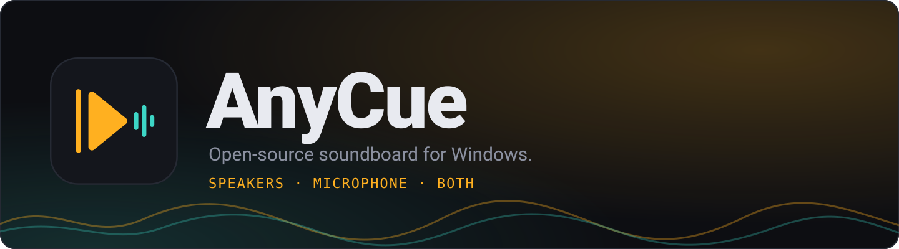
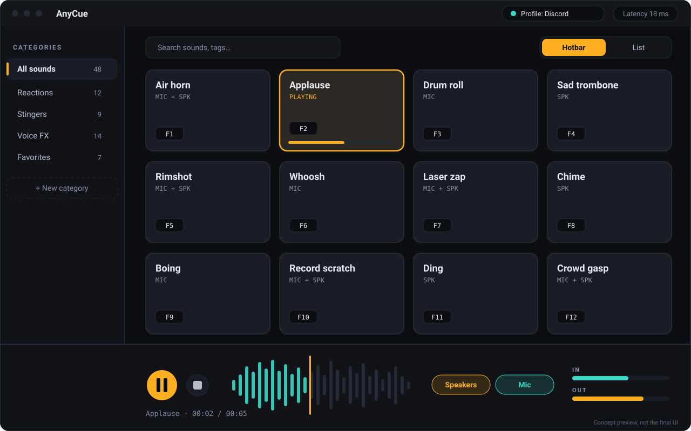
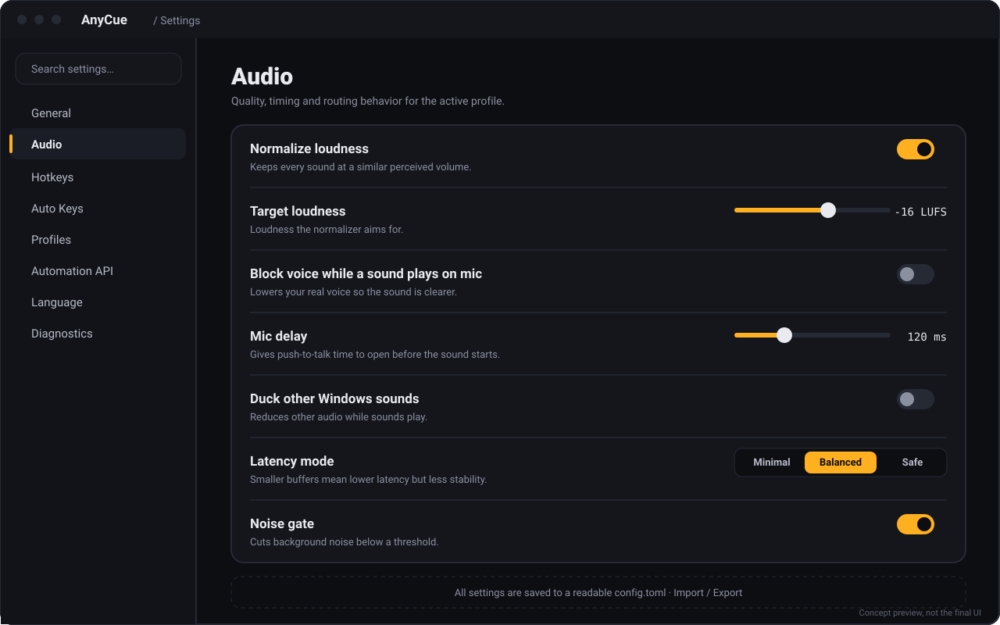
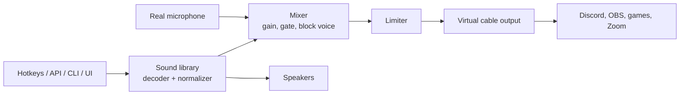

<div align="center">



# AnyCue

**An open-source, fully configurable soundboard for Windows. Play sounds through your speakers, your microphone, or both.**

[](https://github.com/AthilioRecovery/AnyCue/actions)
[](LICENSE)
[](https://github.com/AthilioRecovery/AnyCue/releases)


[English](README.md) · [Português](README.pt-BR.md)

</div>

> **Status: early development.** The architecture and feature set below are the project's design and roadmap. Items are checked off only when they ship. See [Roadmap](#roadmap).

<div align="center">

<br><sub>Concept preview. Real screenshots will replace it as the UI ships.</sub>
</div>

---

## Why this exists

- **Open.** MIT-licensed, readable code, no lock-in.
- **Configurable.** Choose your real microphone, your virtual mic output and your speakers. Every behavior has a setting.
- **Private.** No telemetry and no network calls by default.
- **Scriptable.** The UI is just a client of the same local API that your scripts, Stream Deck and bots can use.

## Features

| Area | What you get |
|---|---|
| **Audio routing** | Pick input mic, virtual mic output and speakers independently; per-sound destination (speakers, mic, both); separate volume controls |
| **Sound quality** | Loudness normalization (LUFS), limiter, optional block-voice, noise gate, ducking, configurable mic delay |
| **Library** | Drag and drop, categories, tags, search, favorites, colors and icons, waveform view, paginated hotbar |
| **Formats** | mp3, wav, ogg, flac, opus, m4a, aac |
| **Hotkeys** | Global shortcuts that work in-game, left/right modifiers, numpad, mouse buttons, conflict detection |
| **Auto Keys** | Holds your push-to-talk key while a sound plays, with per-app profiles |
| **Recorder and editor** | Record mic and/or speakers, trim, fade, gain, unlimited undo, non-destructive export |
| **Text to speech** | Uses voices installed on Windows |
| **Automation** | JSON-RPC 2.0 over named pipe and optional localhost WebSocket, CLI, Python and TypeScript SDKs |
| **Profiles** | Switch whole setups (Discord, Stream, Game) with a hotkey; settings live in a readable `config.toml` |

## Previews

<sub>Concept previews of the planned interface, not final screenshots.</sub>

<p align="center">
  
  
</p>

## How sound reaches your microphone

v1 uses an internal mixer and a **virtual audio cable** (for example VB-Cable or VoiceMeeter), so no custom driver is needed.



A custom virtual driver (C++) that removes the need for a cable is planned as an RFC for v2.

## Install

No release yet. When v0.1.0 ships:

1. Download the installer (`.msi`) or the portable `.zip` from [Releases](https://github.com/AthilioRecovery/AnyCue/releases) and verify the SHA-256 checksum.
2. Install a virtual audio cable (the app will guide you if none is found).
3. Open the app, choose your microphone and the virtual output, and set your communication app's input to the virtual cable.

## Usage (planned interface)

```bash
anycue play "airhorn"
anycue volume 80
anycue doctor
```

```python
# Python SDK (planned)
from anycue import Client

with Client() as app:
    app.play("airhorn", destination="mic")
```

The API is defined once in [`schema/`](schema/) and the SDKs are generated from it. Full reference in [`docs/api.md`](docs/api.md).

## Tech stack

| Layer | Technology |
|---|---|
| Audio engine, mixer, DSP, hotkeys, daemon, API | Rust |
| Desktop UI | TypeScript, Svelte 5, Tauri 2 |
| SDKs | Python, TypeScript |
| Build and release | GitHub Actions, PowerShell |
| Planned (v2) | C++ virtual audio driver |

Design decisions are recorded in [`docs/adr/`](docs/adr/). The real-time audio rules (no allocations, no blocking locks on the audio thread) are in [`docs/realtime-audio.md`](docs/realtime-audio.md).

## Repository layout

```
crates/   Rust crates: core, audio-io, hotkeys, library, tts, recorder, api, daemon, cli
apps/     desktop UI (Tauri + Svelte)
sdk/      Python and TypeScript clients
schema/   API schema (single source of truth)
docs/     documentation, ADRs, RFCs
examples/ Stream Deck, Discord bot, OBS widget
```

## Build from source

```bash
git clone https://github.com/AthilioRecovery/AnyCue.git
cd AnyCue
cargo build --workspace
cargo test --workspace
cd apps/desktop && npm install && npm run tauri dev
```

Requires Windows 10/11, Rust (stable), Node.js 20+.

## Roadmap

- [ ] **M0** Foundation: monorepo, CI, license, docs skeleton
- [ ] **M1** Device listing and playback to a chosen output
- [ ] **M2** Mixer and virtual mic routing, latency measurement
- [ ] **M3** Library, hotbar, waveform, original UI theme
- [ ] **M4** Global hotkeys and Auto Keys
- [ ] **M5** LUFS normalization, block voice, delay, ducking, gate
- [ ] **M6** Recorder, editor, text to speech
- [ ] **M7** Local API, CLI, SDKs, examples
- [ ] **M8** Settings, profiles, i18n, diagnostics, accessibility
- [ ] **M9** v0.1.0 release
- [ ] **v2** Custom virtual audio driver (RFC)

## Contributing

Contributions are welcome. Please read [CONTRIBUTING.md](CONTRIBUTING.md) and [CODE_OF_CONDUCT.md](CODE_OF_CONDUCT.md). Look for issues labeled `good first issue`. Use [Conventional Commits](https://www.conventionalcommits.org/).

Report security problems privately by email to [eu@athiliodev.com.br](mailto:eu@athiliodev.com.br), as described in [SECURITY.md](SECURITY.md).

## FAQ

**Does it need a driver?** Not in v1. It outputs to a virtual cable you install separately.

**Does it collect data?** No. There is no telemetry and no network access by default.

**Is it based on another soundboard?** No. It is an independent, clean-room project that implements the general idea of a soundboard with its own code, protocol, file format and design.

## Contact

- Email: [eu@athiliodev.com.br](mailto:eu@athiliodev.com.br)
- Issues and ideas: [github.com/AthilioRecovery/AnyCue/issues](https://github.com/AthilioRecovery/AnyCue/issues)

## License

[MIT](LICENSE). Third-party dependencies and their licenses are listed in [THIRD_PARTY.md](THIRD_PARTY.md).
