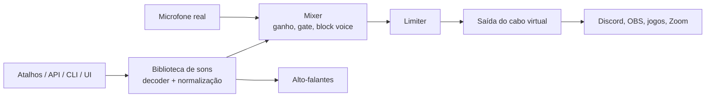

<div align="center">


# AnyCue

**Soundboard open-source e totalmente configurável para Windows. Toque sons nos alto-falantes, no microfone ou nos dois.**

[](https://github.com/AthilioRecovery/AnyCue/actions)
[](LICENSE)
[](https://github.com/AthilioRecovery/AnyCue/releases)


[English](README.md) · [Português](README.pt-BR.md)

</div>

> **Status: em desenvolvimento inicial.** A arquitetura e os recursos abaixo são o planejamento do projeto. Cada item só é marcado quando estiver pronto. Veja o [Roadmap](#roadmap).

<div align="center">

<br><sub>Prévia conceitual. Screenshots reais vão substituí-la conforme a interface for ficando pronta.</sub>
</div>

---

## Por que existe

- **Aberto.** Licença MIT, código legível, sem amarras.
- **Configurável.** Você escolhe o microfone real, a saída de microfone virtual e os alto-falantes. Todo comportamento tem uma configuração.
- **Privado.** Sem telemetria e sem chamadas de rede por padrão.
- **Automatizável.** A interface é só um cliente da mesma API local usada por scripts, Stream Deck e bots.

## Recursos

| Área | O que oferece |
|---|---|
| **Roteamento de áudio** | Entrada, saída de mic virtual e alto-falantes escolhidos separadamente; destino por som (alto-falantes, mic, ambos); volumes independentes |
| **Qualidade do som** | Normalização por loudness (LUFS), limiter, block voice opcional, noise gate, ducking, atraso configurável no mic |
| **Biblioteca** | Arrastar e soltar, categorias, tags, busca, favoritos, cores e ícones, forma de onda, hotbar paginada |
| **Formatos** | mp3, wav, ogg, flac, opus, m4a, aac |
| **Atalhos** | Atalhos globais que funcionam dentro de jogos, modificadores esquerdo/direito, numpad, botões do mouse, detecção de conflitos |
| **Auto Keys** | Segura sua tecla de push-to-talk enquanto o som toca, com perfis por aplicativo |
| **Gravador e editor** | Grava mic e/ou alto-falantes, corta, fade, ganho, desfazer ilimitado, exportação não destrutiva |
| **Texto para voz** | Usa as vozes instaladas no Windows |
| **Automação** | JSON-RPC 2.0 por named pipe e WebSocket local opcional, CLI, SDKs em Python e TypeScript |
| **Perfis** | Troque setups inteiros (Discord, Stream, Jogo) por atalho; configurações em um `config.toml` legível |

## Prévias

<sub>Prévias conceituais da interface planejada, não são screenshots finais.</sub>

<p align="center">
  
  
</p>

## Como o som chega ao microfone

A v1 usa um mixer interno e um **cabo de áudio virtual** (por exemplo VB-Cable ou VoiceMeeter), então não precisa de driver próprio.



Um driver virtual próprio (C++), que dispensa o cabo, está planejado como RFC para a v2.

## Instalação

Ainda não há release. Quando a v0.1.0 sair:

1. Baixe o instalador (`.msi`) ou o `.zip` portátil em [Releases](https://github.com/AthilioRecovery/AnyCue/releases) e confira o checksum SHA-256.
2. Instale um cabo de áudio virtual (o app guia você se não encontrar nenhum).
3. Abra o app, escolha o microfone e a saída virtual, e configure o app de voz para usar o cabo virtual como entrada.

## Uso (interface planejada)

```bash
anycue play "airhorn"
anycue volume 80
anycue doctor
```

```python
# SDK Python (planejado)
from anycue import Client

with Client() as app:
    app.play("airhorn", destination="mic")
```

A API é definida uma única vez em [`schema/`](schema/) e os SDKs são gerados a partir dela. Referência completa em [`docs/api.md`](docs/api.md).

## Tecnologias

| Camada | Tecnologia |
|---|---|
| Motor de áudio, mixer, DSP, atalhos, daemon, API | Rust |
| Interface desktop | TypeScript, Svelte 5, Tauri 2 |
| SDKs | Python, TypeScript |
| Build e release | GitHub Actions, PowerShell |
| Planejado (v2) | Driver de áudio virtual em C++ |

As decisões de projeto ficam em [`docs/adr/`](docs/adr/). As regras de áudio em tempo real (sem alocação e sem lock bloqueante na thread de áudio) estão em [`docs/realtime-audio.md`](docs/realtime-audio.md).

## Estrutura do repositório

```
crates/   crates Rust: core, audio-io, hotkeys, library, tts, recorder, api, daemon, cli
apps/     interface desktop (Tauri + Svelte)
sdk/      clientes Python e TypeScript
schema/   schema da API (fonte única da verdade)
docs/     documentação, ADRs, RFCs
examples/ Stream Deck, bot de Discord, widget de OBS
```

## Compilar a partir do código

```bash
git clone https://github.com/AthilioRecovery/AnyCue.git
cd AnyCue
cargo build --workspace
cargo test --workspace
cd apps/desktop && npm install && npm run tauri dev
```

Requer Windows 10/11, Rust (stable) e Node.js 20+.

## Roadmap

- [ ] **M0** Fundação: monorepo, CI, licença, esqueleto da documentação
- [ ] **M1** Listar dispositivos e tocar em uma saída escolhida
- [ ] **M2** Mixer e roteamento para mic virtual, medição de latência
- [ ] **M3** Biblioteca, hotbar, forma de onda, tema visual original
- [ ] **M4** Atalhos globais e Auto Keys
- [ ] **M5** Normalização LUFS, block voice, atraso, ducking, gate
- [ ] **M6** Gravador, editor, texto para voz
- [ ] **M7** API local, CLI, SDKs, exemplos
- [ ] **M8** Configurações, perfis, i18n, diagnóstico, acessibilidade
- [ ] **M9** Release v0.1.0
- [ ] **v2** Driver de áudio virtual próprio (RFC)

## Contribuindo

Contribuições são bem-vindas. Leia o [CONTRIBUTING.md](CONTRIBUTING.md) e o [CODE_OF_CONDUCT.md](CODE_OF_CONDUCT.md). Procure issues com a label `good first issue`. Use [Conventional Commits](https://www.conventionalcommits.org/).

Problemas de segurança devem ser reportados em privado por e-mail para [eu@athiliodev.com.br](mailto:eu@athiliodev.com.br), conforme o [SECURITY.md](SECURITY.md).

## FAQ

**Precisa de driver?** Não na v1. A saída vai para um cabo virtual que você instala separadamente.

**Coleta dados?** Não. Não há telemetria nem acesso à rede por padrão.

**É baseado em outro soundboard?** Não. É um projeto independente, feito do zero (clean-room), que implementa a ideia geral de um soundboard com código, protocolo, formato de arquivo e design próprios.

## Contato

- E-mail: [eu@athiliodev.com.br](mailto:eu@athiliodev.com.br)
- Issues e ideias: [github.com/AthilioRecovery/AnyCue/issues](https://github.com/AthilioRecovery/AnyCue/issues)

## Licença

[MIT](LICENSE). As dependências de terceiros e suas licenças estão em [THIRD_PARTY.md](THIRD_PARTY.md).
