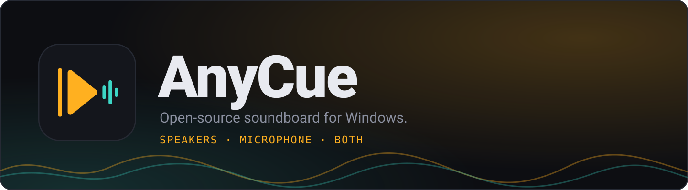
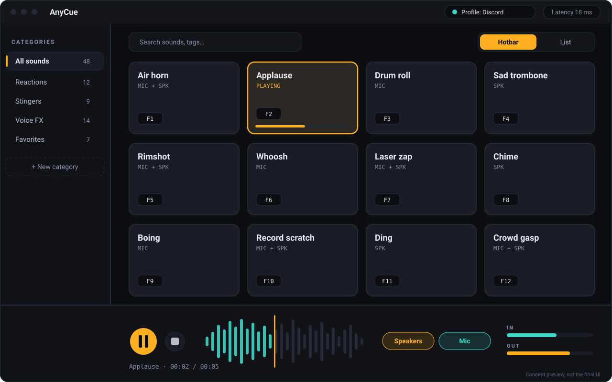

<div align="center">



# AnyCue

**Seus sons, quando quiser.**

Soundboard open-source para Windows 10/11, desenvolvido com Rust, Svelte 5 e Tauri 2.

[](https://github.com/AthilioRecovery/AnyCue/actions/workflows/windows-build.yml)
[](LICENSE)


[English](README.md) · [Português](README.pt-BR.md) · [Instalação Windows](WINDOWS.md) · [Roadmap](docs/ROADMAP.md)

</div>

> **Beta v0.1.0:** é um **aplicativo Windows**, não um site. O executável é compilado pelo GitHub Actions e publicado em Releases. Recursos avançados ainda estão em desenvolvimento.

## Baixar o aplicativo para Windows

1. Acesse a [AnyCue v0.1.0 Beta](https://github.com/AthilioRecovery/AnyCue/releases/tag/v0.1.0).
2. Baixe `AnyCue.exe` (portátil) ou `AnyCue_0.1.0_x64-setup.exe` (instalador).
3. Opcionalmente confira o SHA-256 em `SHA256SUMS.txt` e execute.

Para reproduzir sons como entrada de microfone no Discord ou em jogos, instale separadamente um cabo virtual, como VB-CABLE. O Windows 10 pode precisar do WebView2 Runtime.

**O frontend vem empacotado no executável**, sem site, login ou servidor HTTP em produção. O endereço `127.0.0.1` é usado apenas no desenvolvimento.

## Recursos implementados

| Recurso | Estado |
|---|---|
| Janela desktop com visual escuro e compacto | Implementado |
| Importação de MP3, WAV, OGG, FLAC, Opus, AAC, M4A | Implementado via Symphonia, compatibilidade sujeita a codec |
| Biblioteca local, categorias, busca, favoritos e edição | Implementado |
| Seleção de microfone, alto-falantes e saída virtual | Implementado |
| Reprodução nos alto-falantes, dispositivo virtual ou ambos | Implementado |
| Captura experimental do microfone para mixagem virtual | Implementado, requer teste em dispositivo real |
| Volume principal/individual, parar e VU aproximado | Implementado |
| Atalhos 1–9 e Esc | Apenas com a janela focada |
| Atalhos globais, PTT automático, LUFS, gravador, editor e TTS | Planejados |
| API local, daemon e SDKs Python/TypeScript | Planejados |

A arte abaixo é uma **prévia conceitual antiga**, não uma captura da interface compilada.

<div align="center"></div>

## Estrutura técnica

- `apps/desktop/`: Svelte 5, TypeScript e Tauri 2
- `crates/core/`: funções de DSP testáveis
- `crates/audio-io/`: CPAL/WASAPI e decodificação Symphonia
- `crates/library/`: persistência em JSON versionado
- `crates/cli/`: diagnóstico e reprodução pela linha de comando
- `.github/workflows/`: testes e compilação para Windows

Os streams CPAL ficam em uma thread de áudio dedicada. A biblioteca é mantida no próprio computador. Sem telemetria.

## Compilar no Windows

Instale Node.js 22, Rust MSVC, Visual Studio C++ Build Tools e WebView2.

```powershell
git clone https://github.com/AthilioRecovery/AnyCue.git
cd AnyCue
.\ABRIR-DESKTOP.bat
# Para gerar o EXE: .\COMPILAR-WINDOWS.bat
```

Consulte [WINDOWS.md](WINDOWS.md) para limitações e instruções detalhadas.

## Contribuições e licença

[Roadmap](docs/ROADMAP.md), [Contribuindo](CONTRIBUTING.md), [Segurança](SECURITY.md), [Código de Conduta](CODE_OF_CONDUCT.md). Projeto [MIT](LICENSE). Depedências em [THIRD_PARTY.md](THIRD_PARTY.md).
