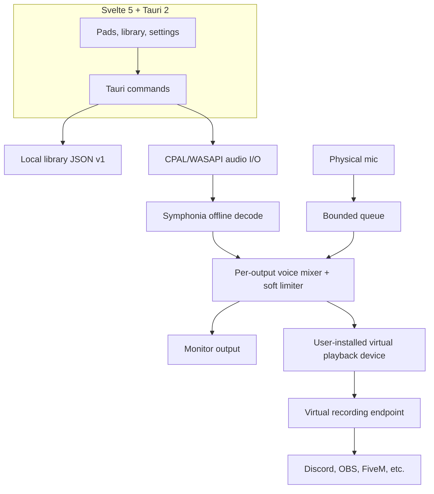

# Architecture (v0.1-alpha)

- `core`: deterministic DSP and tests. No OS APIs or UI dependency.
- `audio-io`: input capture callback, bounded queue, independent monitor/virtual
  output streams, sample decoding off the output callback.
- `library`: JSON v1, local backup and atomic-ish write flow.
- `desktop`: the current Tauri command surface, not the future public API.
- `cli`: direct audio playback and device inspection, not yet a daemon client.
- `preview`: separate Web Audio studio, **not** the Tauri frontend.

There is **no background daemon** and no JSON-RPC socket at this milestone.
The GUI engine lives inside the Tauri process. Consequently audio stops if the
process crashes. The long-term architecture is in `ROADMAP.md`.

## Routing caveats

1. The external cable must be separately installed and correctly selected.
2. The virtual playback device is a normal WASAPI output in this version.
3. Input capture has no adaptive resampling to the virtual output clock yet.
4. Two output streams are best-effort aligned, not sample-accurate synced.
5. Device disconnection requires a manual routing refresh and reconnect.

## Storage

Browser: `IndexedDB` under `http://127.0.0.1:4173`, independent of native app.
Native: `library.json` and `library.json.bak` in Tauri app data directory;
records reference original absolute file paths. No sound file gets copied.
